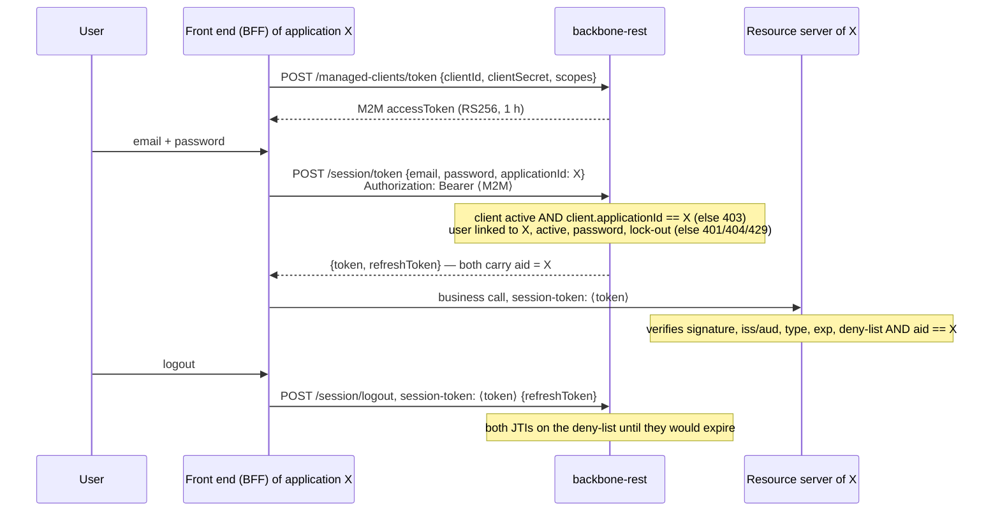

# 🔑 Sessions & Authentication

> **Base path:** `/api/v1/session`  
> **Auth:** Public for a user (no session needed). A front end identifies itself with its managed client: `Authorization: Bearer <M2M>` — see *Applications, users and application clients*

| | |
|---|---|
| **Auth type** | None for the user; optional/required application client (M2M bearer) per application |
| **Token issued** | Session JWT + Refresh JWT (JJWT 0.12.3) |
| **Session TTL** | ~1 hour |
| **Refresh TTL** | ~7 days |

[← Back to API Index](./README.md)

---

## 🧭 Applications, users and application clients

Backbone owns identity for every product. Three things take part in a login, and none is optional in the model:

| Piece | What it is | Managed with |
|---|---|---|
| **Application** | The product (tenant): `zerobound`, `mercury`, the backoffice… Users and roles exist *inside* an application (`ApplicationRoleUser`). | `/api/v1/applications` |
| **Application user** | A person linked to that application with a role (administrator, customer, …). The same person may be a user of several applications. | `/api/v1/users`, role links |
| **Application client** | The front end / BFF of the application, as a managed client (MCAM): `clientId` + `clientSecret`, bound to **one** `applicationId`. | `/api/v1/managed-clients` |



Rules backbone enforces:

- **`aid` claim.** Session and refresh tokens name the application they were issued for (`aid`). Every service shares the
  signing secret, so a resource server **must** require `aid` to equal its own application id; otherwise a session of
  application A is accepted by application B. Renew and refresh keep the `aid` and re-check that the user still belongs to it.
- **Client ↔ application.** A managed client presented in `Authorization: Bearer` on login / renew / refresh must be active
  and belong to the application of the session: `403` otherwise.
- **Client required.** Applications listed in `SESSION_CLIENT_REQUIRED_APPLICATIONS` (comma-separated ids), or all of them
  with `SESSION_CLIENT_REQUIRED=true`, cannot open, renew or refresh a session without their client: `401`. Applications not
  listed keep working without a client, so each one moves over when its front end is ready.
- **Logout.** `POST /api/v1/session/logout` puts the session token (and the refresh token of the same user) on the deny-list.
- Tokens issued before this (no `aid`) still renew/refresh as before and stay without `aid`; a resource server that requires
  the claim rejects them, i.e. those users sign in again.

Setting up an application end to end: [`docs/runbooks/zerobound-application-client.md`](../runbooks/zerobound-application-client.md).

---

## 🔵 POST /api/v1/session

> Login using an application alias and password. Returns a session token and refresh token.

> [!NOTE]
> Use this endpoint when the client identifies the user by their **alias** (username). For email-based login, use `POST /api/v1/session/token`.

> [!NOTE]
> The issued `sessionToken` embeds a `uid` claim identifying the authenticated user (matches
> the claim already set by `POST /api/v1/session/token`). Downstream services rely on it to
> resolve caller identity for application-scoped authorization — see
> [`applicationId`-scoped checks](./iam-permissions.md#how-it-works) in `POST /api/v1/iam/permissions/check`.
> Tokens minted before this fix carry no `uid` and fall back to that endpoint's global,
> cross-application `roles` claim instead.

### 📋 Request Headers

| Header | Required | Value |
|--------|----------|-------|
| `Content-Type` | Yes | `application/json` |

### 📦 Request Body

| Field | Type | Required | Constraints | Description |
|-------|------|----------|-------------|-------------|
| `alias` | `string` | Yes | Non-blank | User's login alias (username) |
| `password` | `string` | Yes | Non-blank | User's plaintext password |
| `applicationId` | `UUID` | Yes | Valid UUID v4 | Application context for multi-tenant auth |

```json
{
  "alias": "jdoe",
  "password": "s3cr3t",
  "applicationId": "a1b2c3d4-e5f6-7890-abcd-ef1234567890"
}
```

### 📡 Responses

| Status | Meaning | When |
|--------|---------|------|
| `200 OK` | Login successful | Credentials valid |
| `401 Unauthorized` | Bad credentials | Wrong alias or password |
| `404 Not Found` | Resource not found | Application ID not found or null payload |

**200 OK — Response body:**

```json
{
  "sessionToken": "eyJhbGciOiJIUzUxMiJ9...",
  "refreshToken": "eyJhbGciOiJIUzUxMiJ9..."
}
```

> [!TIP]
> Store both tokens securely. Pass `sessionToken` as the `session-token` header on subsequent calls. Use `refreshToken` with `POST /api/v1/session/refresh` when the session expires.

### 💡 Example

```bash
curl -k -s -X POST https://<host>:8084/api/v1/session \
  -H "Content-Type: application/json" \
  -d '{
    "alias": "jdoe",
    "password": "s3cr3t",
    "applicationId": "a1b2c3d4-e5f6-7890-abcd-ef1234567890"
  }'
```

---

## 🔵 POST /api/v1/session/token

> Login using an email address and password. Returns a session token and refresh token.

> [!NOTE]
> Functionally equivalent to `POST /api/v1/session` but accepts an **email** instead of an alias.

### 📋 Request Headers

| Header | Required | Value |
|--------|----------|-------|
| `Content-Type` | Yes | `application/json` |

### 📦 Request Body

| Field | Type | Required | Constraints | Description |
|-------|------|----------|-------------|-------------|
| `email` | `string` | Yes | Valid email format | User's registered email address |
| `password` | `string` | Yes | Non-blank | User's plaintext password |
| `applicationId` | `UUID` | Yes | Valid UUID v4 | Application context for multi-tenant auth |

```json
{
  "email": "jdoe@example.com",
  "password": "s3cr3t",
  "applicationId": "a1b2c3d4-e5f6-7890-abcd-ef1234567890"
}
```

### 📡 Responses

| Status | Meaning | When |
|--------|---------|------|
| `200 OK` | Login successful | Credentials valid |
| `401 Unauthorized` | Bad credentials | Wrong email or password |
| `404 Not Found` | Resource not found | Application ID not found or null payload |

**200 OK — Response body:**

```json
{
  "sessionToken": "eyJhbGciOiJIUzUxMiJ9...",
  "refreshToken": "eyJhbGciOiJIUzUxMiJ9..."
}
```

### 💡 Example

```bash
curl -k -s -X POST https://<host>:8084/api/v1/session/token \
  -H "Content-Type: application/json" \
  -d '{
    "email": "jdoe@example.com",
    "password": "s3cr3t",
    "applicationId": "a1b2c3d4-e5f6-7890-abcd-ef1234567890"
  }'
```

---

## 🟢 GET /api/v1/session/validate

> Validate whether a session token is still active and not expired.

> [!NOTE]
> This endpoint does not renew the token. Use `GET /api/v1/session/renew` to extend the session.

### 📋 Request Headers

| Header | Required | Description |
|--------|----------|-------------|
| `session-token` | Yes | The session JWT to validate |
| `Authorization` | No (deprecated) | Raw token, read only when `session-token` is absent (legacy callers such as security-oauth's `BackbonePublicClient.validate`) |

### 📡 Responses

| Status | Meaning | When |
|--------|---------|------|
| `200 OK` | `true` for a current `session-token` whose JTI is not revoked; `false` for a wrong `type` or a revoked JTI | |
| `400 Bad Request` | Missing or blank header | body `false` |
| `401 Unauthorized` | Token invalid | Expired or malformed token (body `false`) |

**200 OK — Response body:**

```json
true
```

> [!CAUTION]
> The response is a raw JSON boolean (`true`), not an object wrapper. Parse accordingly.

### 💡 Example

```bash
curl -k -s -X GET https://<host>:8084/api/v1/session/validate \
  -H "session-token: eyJhbGciOiJIUzUxMiJ9..."
```

---

## 🟢 GET /api/v1/session/renew

> Renew a session token before it expires. Returns a new session JWT with a refreshed expiry timestamp.

> [!TIP]
> Call this endpoint proactively (e.g., when less than 10 minutes remain) to keep the user's session alive without requiring re-authentication.

### 📋 Request Headers

| Header | Required | Description |
|--------|----------|-------------|
| `session-token` | Yes | The current (still-valid) session JWT |

### 📡 Responses

| Status | Meaning | When |
|--------|---------|------|
| `200 OK` | Token renewed | New session JWT issued |
| `400 Bad Request` | Missing token | neither `session-token` nor (deprecated) raw `Authorization` present |
| `401 Unauthorized` | Token invalid | Expired or tampered token, user removed from the application of the session, or application client required and missing |
| `403 Forbidden` | Wrong client | The managed client presented does not belong to the application of the session |
| `404 Not Found` | User not found | Subject in token no longer exists |
| `500 Internal Server Error` | Server error | Unexpected failure during renewal |

**200 OK — Response body:**

```json
{
  "sessionToken": "eyJhbGciOiJIUzUxMiJ9..."
}
```

> [!WARNING]
> The old `sessionToken` is not explicitly revoked server-side after renewal — it remains valid until its original expiry. Discard it client-side immediately after receiving the new one.

### 💡 Example

```bash
curl -k -s -X GET https://<host>:8084/api/v1/session/renew \
  -H "session-token: eyJhbGciOiJIUzUxMiJ9..."
```

---

## 🔵 POST /api/v1/session/logout

> End a session: revoke its session token and, optionally, its refresh token.

| Header | Required | Description |
|--------|----------|-------------|
| `session-token` | Yes | The session JWT to revoke |

Body (optional): `{ "refreshToken": "<refresh-jwt>" }`. It is revoked only when it belongs to the same user as the session token.

| Status | Meaning | When |
|--------|---------|------|
| `204 No Content` | Revoked | Both JTIs are on the deny-list (`jti:<jti>` in Redis) until the tokens would have expired |
| `400 Bad Request` | Nothing revoked | Header missing, or not a token signed by this service |

After it: `GET /session/validate` answers `false`, `POST /session/refresh` answers `401`, and services that read the deny-list
(zerobound-rest, mercury) reject the token. A `LOGOUT` audit event is recorded.

```bash
curl -k -s -X POST https://<host>:8084/api/v1/session/logout \
  -H "session-token: eyJhbGciOiJIUzUxMiJ9..." -H "Content-Type: application/json" \
  -d '{"refreshToken":"eyJhbGciOiJIUzUxMiJ9..."}' -o /dev/null -w '%{http_code}\n'    # 204
```

---

## 🔵 POST /api/v1/session/refresh

> The new tokens keep the application (`aid`) of the refresh token. `401` when the refresh token was revoked at logout or the
> user no longer belongs to that application; `401`/`403` for the application client as in login.

> Exchange a refresh token for a fresh session token and a new refresh token.

> [!NOTE]
> Use this endpoint after the session token has expired. The refresh token has a longer TTL (~7 days). Once the refresh token expires, the user must log in again.

### 📋 Request Headers

| Header | Required | Value |
|--------|----------|-------|
| `Content-Type` | Yes | `application/json` |

### 📦 Request Body

| Field | Type | Required | Constraints | Description |
|-------|------|----------|-------------|-------------|
| `refreshToken` | `string` | Yes | Non-blank, valid JWT | The refresh token received at login or previous refresh |

```json
{
  "refreshToken": "eyJhbGciOiJIUzUxMiJ9..."
}
```

### 📡 Responses

| Status | Meaning | When |
|--------|---------|------|
| `200 OK` | Tokens refreshed | New session + refresh tokens issued |
| `400 Bad Request` | Null or malformed body | Missing `refreshToken` field |
| `401 Unauthorized` | Refresh token invalid | Expired, tampered, or revoked |
| `500 Internal Server Error` | Server error | Unexpected failure |

**200 OK — Response body:**

```json
{
  "sessionToken": "eyJhbGciOiJIUzUxMiJ9...",
  "refreshToken": "eyJhbGciOiJIUzUxMiJ9..."
}
```

> [!WARNING]
> Treat the refresh token as a secret credential. Do not log it or expose it in URLs.

### 💡 Example

```bash
curl -k -s -X POST https://<host>:8084/api/v1/session/refresh \
  -H "Content-Type: application/json" \
  -d '{"refreshToken": "eyJhbGciOiJIUzUxMiJ9..."}'
```

---

## 🚨 Error Reference

| Status | Code | Applies to |
|--------|------|-----------|
| `400 Bad Request` | Missing/malformed body | `POST /refresh`, `GET /renew` |
| `401 Unauthorized` | Invalid credentials or token | All endpoints |
| `404 Not Found` | User or application not found | `POST /`, `POST /token`, `GET /renew` |
| `500 Internal Server Error` | Unexpected server failure | `GET /renew`, `POST /refresh` |

---

[← Back to API Index](./README.md)
